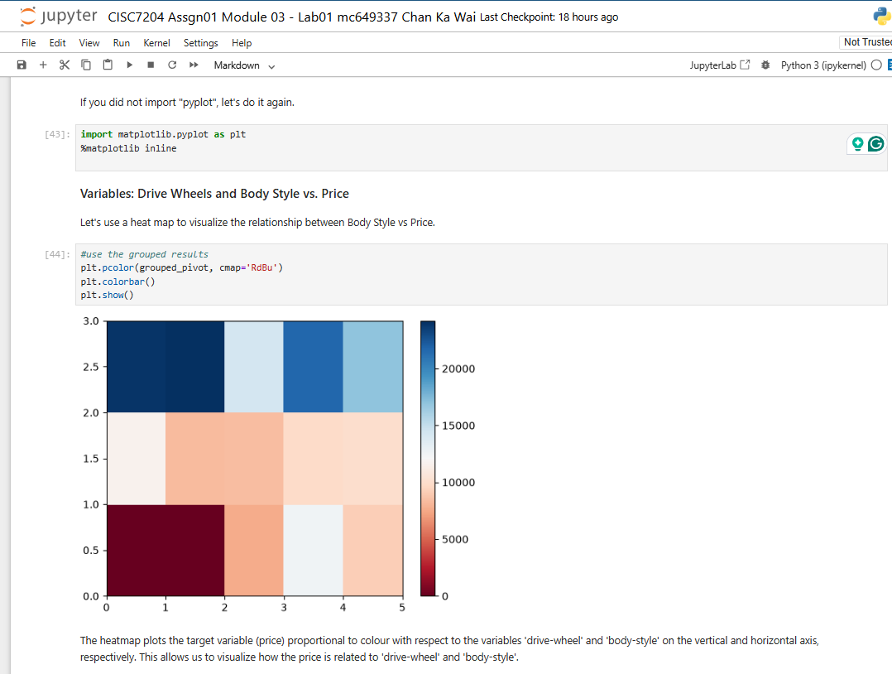
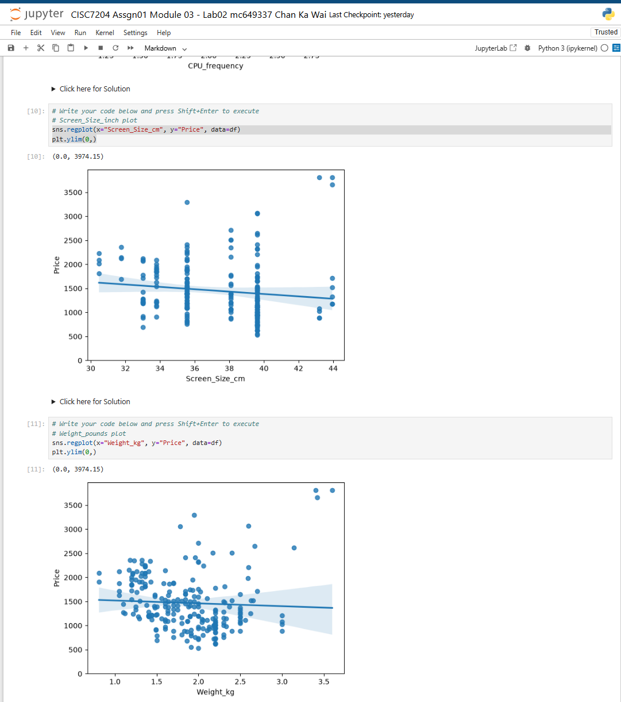

# CISC7204 Assignment 01 - Data analysis with Python

Chan Ka Wai (mc649337) · Class D · University of Macau

Artifacts of my Assignment 01 work: six modules of data-analysis labs (data importing, wrangling,
exploratory analysis, model development and model evaluation) and the pair preliminary project.

- **Repository:** <https://github.com/Kelvin-Chan-Ka-Wai/CISC7204-mc649337-2026GitHub>
- **Live showcase of Assignment 02:** <https://kelvin-chan-ka-wai.github.io/CISC7204-mc649337-2026GitHub/>
- **Project status:** complete and submitted (Assignment 01, due 2026SEP20). The BONUS portfolio
  registration for this assignment was posted in the Class D registration forum on 2026NOV05.

## What is in this folder

| Path | Content |
|---|---|
| `Module 01.zip` … `Module 06.zip` | each module packaged with its notebooks, screenshots and datasets (self-contained) |
| `Pair Preliminary Project/` | the Cambridgeshire road-collision pair project: proposal, analysis notebook, verification notebook, data and figures |
| `README.md` | this file |

## Modules

| Module | Topic | Labs |
|---|---|---|
| Module 01 | Importing datasets | Lab01 Importing a dataset · Lab02 Practice lab: laptop pricing |
| Module 02 | Data wrangling | Lab01 Missing values and data formats · Lab02 Practice lab: data wrangling |
| Module 03 | Exploratory data analysis | Lab01 Correlation and grouping · Lab02 Practice lab: laptop pricing EDA |
| Module 04 | Model development | Lab01 Simple and multiple linear regression, polynomial regression and pipelines · Lab02 Practice lab |
| Module 05 | Model evaluation and refinement | Lab01 Train/test split, cross-validation and ridge regression · Lab02 Practice lab |
| Module 06 | Practice and final project | Practice Project: insurance cost analysis · Final Project: house sales analysis and price prediction |

Each module ZIP contains:

```
Module 0X/
  CISC7204 Assgn01 Module 0X - Lab01 mc649337 Chan Ka Wai.ipynb
  CISC7204 Assgn01 Module 0X - Lab02 mc649337 Chan Ka Wai.ipynb   (where the module has a practice lab)
  lab1_1.png … lab1_N.png            screenshots of every task
  jupyter notebook folder ....png    the folder view of the notebooks
  *.csv                              the datasets used
```

Module 06 also contains `Final Project.zip` and `Practice Project.zip` with the two project notebooks
and their screenshots.

## What I did in each module

1. **Module 01** - imported the car-price and laptop datasets with pandas, inspected types and basic
   statistics and noted the first insights about the data.
2. **Module 02** - identified and handled missing values (mean/median replacement, dropping columns),
   corrected data formats and saved the cleaned data frame.
3. **Module 03** - exploratory data analysis: correlation tables and heatmaps, grouping by categorical
   variables (drive wheels, body style) and box plots to see how price changes between groups.
4. **Module 04** - built regression models with `scikit-learn`: simple and multiple linear regression,
   polynomial features, and pipelines with standardisation.
5. **Module 05** - evaluated and refined the models: train/test split, cross-validation with
   `cross_val_score`, ridge regression, and used `GridSearchCV` to tune the parameters.
6. **Module 06** - two complete projects: the insurance cost analysis (practice project) and the house
   sales final project, following the full workflow: import the data, wrangle it, explore it, build a
   model and evaluate/refine it.

## Skills demonstrated

pandas loading and cleaning · seaborn and Matplotlib charts (heatmap, box plot, regression plot,
pair plot) · correlation analysis with SciPy · scikit-learn linear, multiple and polynomial
regression · pipelines with standardisation · train/test split and cross-validation · ridge
regression and `GridSearchCV` · reading model coefficients back into a business question.

## Visualisations

Two figures from Module 03; the full set of task screenshots sits inside each module ZIP.



*Figure 1 - mean price by drive-wheels (vertical) and body-style (horizontal). The colour bar is
price in USD: rear-wheel-drive two-door and convertible bodies carry the highest means.*



*Figure 2 - seaborn regression plots from Module 03 Lab 02: price against screen size (top) and
price against weight (bottom), each with a 95% confidence band. The bands are wide and the slopes
shallow, which is exactly why Modules 04-05 add more predictors.*

## Datasets

| Dataset | Used in |
|---|---|
| `auto.csv`, `usedcars.csv`, `module_5_auto.csv` | modules 01–05 (car price analysis) |
| `laptops.csv`, `laptop_pricing_dataset_base.csv`, `laptop_pricing_dataset_mod2.csv` | practice labs of modules 01–05 (laptop pricing) |
| `clean_df.csv` | module 02 (cleaned data frame) |
| `housing.csv`, `kc_house_data_NaN.csv` | module 06 final project (house sales) |
| `medical_insurance_dataset.csv` | module 06 practice project (insurance cost analysis) |

All datasets are included inside the module ZIPs, so each module can be run on its own.

### Dataset sources and usage permissions

The datasets are the course tutorial files, redistributed here only so that the submitted
notebooks can be re-run and checked. Upstream sources where they are known:

| Dataset | Upstream source | Permission |
|---|---|---|
| `auto.csv`, `usedcars.csv`, `module_5_auto.csv` | UCI Machine Learning Repository, Automobile data set | CC BY 4.0 |
| `housing.csv`, `kc_house_data_NaN.csv` | public King County (WA) house-sales extract used in the course | public data, teaching use |
| `laptops.csv`, `laptop_pricing_dataset_*.csv` | course teaching sample (laptop pricing) | course material |
| `medical_insurance_dataset.csv` | course teaching sample (insurance cost) | course material |
| `clean_df.csv` | derived from `auto.csv` by the Module 02 notebook | derived |

No restricted, licensed or personally identifying data are redistributed in this folder.

## Key findings

- **Module 03:** price rises with engine size, horsepower and curb weight, and the drive-wheel
  groups have clearly different mean prices - the heatmap and the grouped box plots show the same
  ordering.
- **Modules 04-05:** the multiple-regression model fits materially better than the single-variable
  one, and the cross-validated ridge model removes most of the train/test gap that the plain linear
  model shows.
- **Module 06:** the house-sale models are dominated by living area, grade and location; the
  insurance model by smoker status, age and BMI.
- **Pair project:** recorded collisions cluster by district and month, and severity differs across
  road-surface and weather conditions.

The exact coefficients, scores and figures are in the notebooks and in the task screenshots.

## Limitations

The labs use the course tutorial datasets, so the models describe these samples rather than a
population - there is no external validation set. The car-price file is a small curated sample, the
Module 06 house data cover a single county, and the pair project uses one county's recorded
collisions for 2012-2017; none of the coefficients should be read as general price or risk effects.
The analysis is descriptive and predictive, not causal.

## Review and deployment testing

Two members of Class D tested the GitHub Pages deployment of this assignment: **GUO YUANQI
(MC649062)** and **ZHOU ZIROU (MC648937)**. Their findings - broken directory links, the six module
archives not being reachable from the live site - and the commit that answers each one are recorded
in [`REVIEW.md`](REVIEW.md). The assignment 02 review used a different pair, so no member reviews
both assignments.

## How to run it

Requirements: Python 3.10+ with

```bash
python -m pip install pandas numpy matplotlib seaborn scikit-learn
```

Unzip the module you want, open its folder in a terminal and start Jupyter:

```bash
jupyter notebook
```

Then open the Lab01/Lab02 notebook and run it from top to bottom.

## Pair Preliminary Project

The pair project (Chan Ka Wai, mc649337 + Liu Haixiang, mc649298) studies **Cambridgeshire road
collision patterns (2012–2017)**: how recorded collisions vary by district and month and how severity
differs across road-surface and weather conditions.

| File | What it is |
|---|---|
| `CISC7204-Assgn01-mc649337-PreliminaryProjectProposal.docx` | the project proposal (topic, research questions, data sources, plan) |
| `collision_patterns_analysis.ipynb` | the analysis notebook: data acquisition, cleaning/harmonisation, primary and supplementary analysis and the figures |
| `CISC7204_Verification_Notebook.ipynb` | verification notebook: source log, data audit, cleaning checks and re-computation of the analysis |
| `collision_patterns_analysis.py` | the same analysis as a plain Python script |
| `data.zip` | the raw datasets used by the notebooks |
| `figures.zip` | the exported figures |
| `README.md` | short note about the pair project files |

Run the pair notebooks the same way: unzip `data.zip`, `python -m pip install pandas numpy matplotlib
seaborn`, then `jupyter notebook` and run the analysis notebook from the top.

## Reflection (~200 words)

Assignment 01 taught me that a model is only as good as the question asked of it. The six modules
move from importing a messy CSV to tuning a regularised regression, and the step that changed my
practice most was learning to look at the data before modelling it: the Module 03 heatmap showed
that engine size, horsepower and curb weight move together, which meant a multiple regression on
all three would not tell me which one mattered. Module 05 then showed the cost of ignoring that -
a plain linear model fitted the training data well and the test data badly, and cross-validated
ridge regression closed most of the gap. I also learned to keep the whole path reproducible: every
notebook runs top to bottom, the datasets ship with the modules, and the pair project keeps a
verification notebook that recomputes the analysis from the raw files. My next improvement is to
treat model output as evidence rather than an answer - reporting intervals and residual checks
alongside R2, and stating in advance which predictors I expect to survive on a different sample.

## Declaration of AI usage

Declaration of AI Usage - mc649337 CHAN KA WAI
Did I use an AI LLM? Yes
Exact LLM used: DeepSeek-V4.1-Flash
Web Browser used: Google Chrome

Scope of use: I used DeepSeek-V4.1-Flash as a discussant while debugging notebook errors and while
checking that the figure captions matched the numbers my own code produced. The analysis, the
notebooks, the screenshots and the conclusions are my own work.

## Responsible sharing

No passwords, API keys, personal data or restricted datasets are included in this folder. The
datasets are the course tutorial files, redistributed only so the notebooks can be re-run, with
upstream sources and permissions listed above. The pair preliminary project uses published
Cambridgeshire road-collision data.
