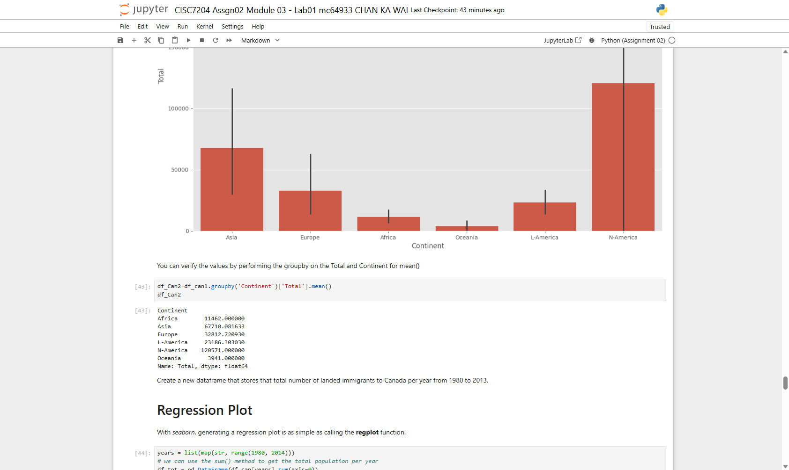
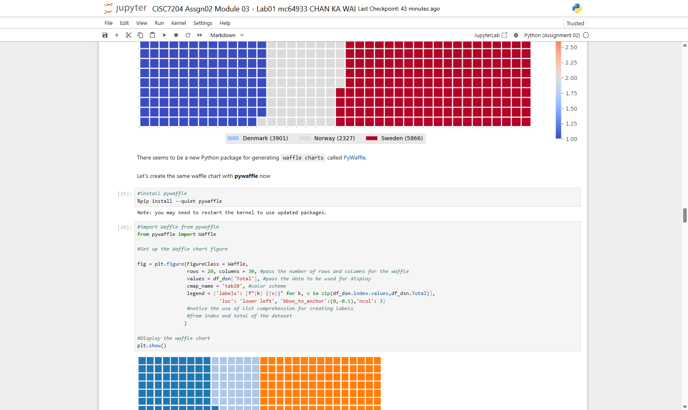
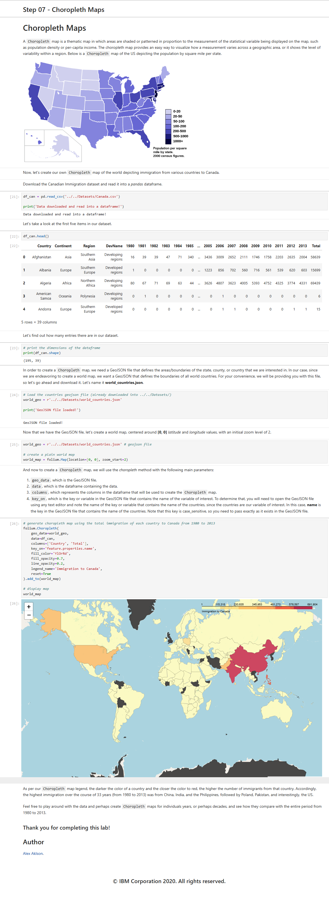
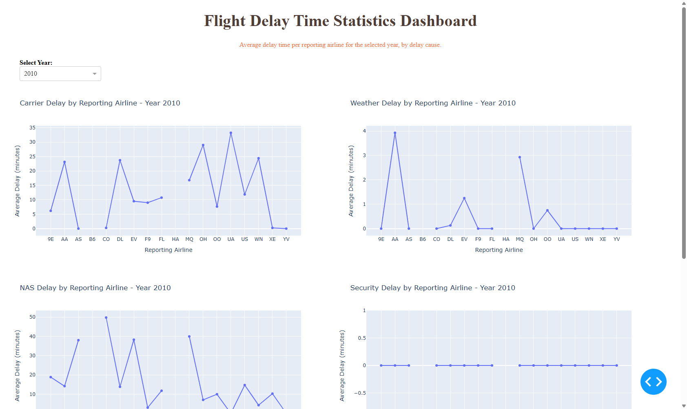
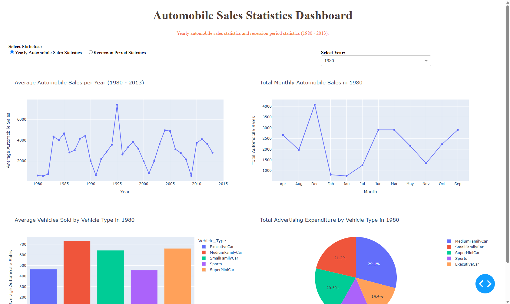

# CISC7204 Assignment 02 - Data visualization with Python

Chan Ka Wai (mc649337) · Class D · University of Macau

Artifacts of my Assignment 02 work: the notebooks executed from top to bottom, the screenshots of
every task with its output, and the Dash project spaces.

- **Live showcase:** <https://kelvin-chan-ka-wai.github.io/CISC7204-mc649337-2026GitHub/>
- **Repository:** <https://github.com/Kelvin-Chan-Ka-Wai/CISC7204-mc649337-2026GitHub>
- **Project status:** complete and submitted (Assignment 02, due 2026OCT25). The BONUS portfolio
  registration for this assignment was posted in the Class D registration forum on 2026NOV05.

## What is in this folder

| Path | Content |
|---|---|
| `Datasets/` | datasets used by the labs (Canada immigration, police incidents, airline data, wildfires, automobile sales, `us-states.json`, `world_countries.json`) |
| `Module 01/` … `Module 05/` | each module has `Jupyter Notebooks/`, `Screen Shots/` and, where required, `Project Spaces/` |
| `Module01.zip` … `Module 05.zip` | each module packaged (notebooks + screenshots + project spaces) |
| `Pair Project Proposal/` | revised pair project proposal (Pair 04) |

## Modules

| Module | Labs | Main tools |
|---|---|---|
| [Module 01](Module%2001) | Lab01 Exploring and pre-processing a dataset with Pandas · Lab02 Introduction to Matplotlib and line plots | pandas, matplotlib |
| [Module 02](Module%2002) | Lab01 Area plots, histograms and bar charts · Lab02 Pie charts, box plots, scatter and bubble plots · Lab03 Plotting directly with Matplotlib | pandas, matplotlib |
| [Module 03](Module%2003) | Lab01 Waffle charts, word clouds and regression plots · Lab02 Maps and geospatial data | pywaffle, wordcloud, seaborn, folium |
| [Module 04](Module%2004) | Lab01 Plotly basics · Lab02 Dash basics · Lab03 Interactivity and callbacks · Lab04 Flight delay statistics dashboard | plotly, dash, Theia |
| [Module 05](Module%2005) | Practice Lab01 Wildfire activities in Australia · Practice Lab02 Creating dashboards · Final Lab01 Visualizations with Matplotlib, Seaborn and Folium · Final Lab02 Dashboard with Plotly and Dash | pandas, seaborn, matplotlib, folium, plotly, dash |

## What I did in each module

1. **Module 01** - cleaned and explored the Canadian immigration dataset with pandas, then drew the
   first line plots with Matplotlib.
2. **Module 02** - area plots, histograms and bar charts, then pie charts, box plots, scatter and
   bubble plots, then plotting straight from the Matplotlib object API.
3. **Module 03** - built waffle charts (by hand and with `pywaffle`), word clouds (including a masked
   cloud), regression plots with seaborn and interactive folium maps with markers and a choropleth.
4. **Module 04** - Plotly basics plus four Dash applications; each script is split into `# TASK n`
   sections and every task has a screenshot taken in the Theia IDE.
5. **Module 05** - the wildfire practice project (time series, distributions, pies, scatter and a
   regional folium map) and the final project (matplotlib/seaborn/folium charts for automobile sales
   and a two-report Plotly + Dash dashboard).

## Skills demonstrated

pandas reshaping (pivot, melt, groupby) · Matplotlib line, area, bar, pie and box plots ·
seaborn regression, violin and heatmap charts · word clouds and waffle charts · folium dot-density,
choropleth and marker maps · Plotly express and graph objects · Dash layouts, callbacks and
multi-report dashboards · capturing reproducible screenshot evidence per task.

## Visualisations

Five figures taken from the modules; every task has its own screenshot under
`Module 0X/Screen Shots/`. Each chart has a title, axis labels and a caption naming the finding.



*Figure 1 - Module 03 bar plot: the ranking of source countries is dominated by a handful of
origins, which is why the later waffle and word-cloud views reuse the same ranking.*



*Figure 2 - Module 03 waffle chart: Denmark 3,901, Norway 2,327 and Sweden 5,866 immigrants shown
as unit squares, with the legend and the colour scale visible.*



*Figure 3 - Module 03 Lab 02 folium choropleth: the same country totals placed on the world map,
so the geographic concentration is visible instead of read off a bar.*



*Figure 4 - Module 04 Lab 04 Dash application: delay counts by hour and carrier, with the
dropdown and the two report tabs that let a reader filter the data.*



*Figure 5 - Module 05 final project dashboard (Plotly + Dash): mean price and sales volume by
make, with the interactive filter panel on the left.*

## Research question

Each module answers one question about the same data story: what changes when the same result is
shown as a time series, as a ranking, as a distribution and as a map? The modules build up the
chart vocabulary (pandas, Matplotlib, seaborn, folium, Plotly, Dash) and end with two dashboards
that let a reader explore the data instead of reading a static figure.

## Key findings

- **Modules 01-02:** immigration to Canada from Asia rises fastest across 1980-2013 while the
  European share falls; the line, area and bar views each make a different part of that shift
  readable.
- **Module 03:** the waffle and word-cloud views show that a few source countries dominate the
  totals, and the folium choropleth shows where those totals sit geographically.
- **Module 04:** the flight-delay dashboard shows delay counts concentrating in particular hours
  and carriers rather than spreading evenly across the day.
- **Module 05:** the wildfire dashboard shows a strong seasonal pattern and a small number of
  regions accounting for most of the burned area; the automobile-sales dashboard shows how mean
  price and sales volume move in opposite directions across makes.

The exact numbers are in the notebooks and in the task screenshots.

## Limitations

The labs are teaching exercises on fixed extracts: the police-incident file is a single year in a
single city, the wildfire data cover one country, and the immigration file is a historical extract
that stops in 2013. The dashboards are descriptive - they show what happened in these files, not
why - and no model or causal claim is made.

## Dataset sources and usage permissions

| Dataset | Upstream source | Permission |
|---|---|---|
| `Canada.csv`, `Canada.xlsx` | course tutorial extract of Canadian immigration statistics | course material |
| `Police_Department_Incidents_-_Previous_Year__2016_.csv` | DataSF, San Francisco Police Department incident reports (open data) | public open data |
| `airline_data.csv` | course tutorial flight-delay sample | course material |
| `Historical_Wildfires.csv` | course tutorial extract of Australian wildfire records | course material |
| `automobile-sales.csv` | course tutorial automobile-sales sample | course material |
| `us-states.json`, `world_countries.json` | public GeoJSON boundary files used for the choropleth and folium maps | public data |

The files are redistributed only so that the submitted notebooks and dashboards can be re-run. No
restricted, licensed or personally identifying data are redistributed in this folder.

## Review and deployment testing

Two members of Class D tested the GitHub Pages deployment of this assignment: **WANG XIAOYANG
(MC652114)** and **LUO JUNPENG (MC651023)**. Their findings - the student number rendering as
`mc64933 7`, the broken directory links, the missing testing record and raw-filename `alt` text -
and the commit that answers each one are recorded in [`REVIEW.md`](REVIEW.md). The assignment 01
review used a different pair, so no member reviews both assignments.

## How to run it

Requirements: Python 3.10+ with

```bash
python -m pip install -r requirements.txt
```

(`requirements.txt` in this folder pins pandas, numpy, matplotlib, seaborn, folium, plotly,
dash, pywaffle and wordcloud.)

**Notebooks**

```bash
jupyter notebook
```

then open any notebook inside `Module 0X/Jupyter Notebooks/` and run it from top to bottom.

**Dash applications**

```bash
cd "Module 04/Project Spaces/CISC7204 Assgn02 Module 04 - Lab02 mc649337 Chan Ka Wai"
python -m pip install -r requirements.txt
python dash_basics.py
```

The URL is printed in the terminal; `CTRL+C` stops the application. The Module 05 practice and final
project spaces are started the same way (`Dash_wildfire.py`, `Dash_automobile.py`).

## Screenshots

Every task has its own screenshot in `Module 0X/Screen Shots/`. They are named after the task, so the
order in the folder follows the order of the work in the notebook or Dash script. The dashboards were
captured while the application was running in the browser.

## Reflection (~200 words)

Assignment 02 is where visualisation stopped being decoration for me. The same Canadian
immigration data can be a line chart, an area chart, a waffle, a word cloud or a choropleth, and
each one hides something the others show: the line chart makes the rise of Asia obvious but
flattens the country mix, the waffle makes the ranking readable but loses time, and the map shows
concentration but not trend. Building the Dash dashboards forced the point home, because a reader
can filter the data and immediately expose a claim that only held for the default view. I also
learned how much of the work is not the chart: naming screenshots so a reviewer can follow the
notebook, keeping the project spaces runnable from a requirements file, and checking that a
dashboard still says something useful when the dropdown is empty. My next improvement is to add
linked views - brushing a region on the map to filter the trend chart - so the dashboard answers a
question instead of presenting a menu of charts.

## Declaration of AI usage

Declaration of AI Usage - mc649337 CHAN KA WAI
Did I use an AI LLM? Yes
Exact LLM used: DeepSeek-V4.1-Flash
Web Browser used: Google Chrome

Scope of use: I used DeepSeek-V4.1-Flash as a discussant while debugging Dash callbacks and while
checking that the figure captions matched the numbers my own code produced. The analysis, the
notebooks, the screenshots and the conclusions are my own work.

## Responsible sharing

No passwords, API keys, personal data or restricted datasets are included in this folder. The
datasets are the course tutorial files, redistributed only so the notebooks and dashboards can be
re-run, with upstream sources and permissions listed above. The San Francisco incident extract is
public open data and is used at city level, not per person.
