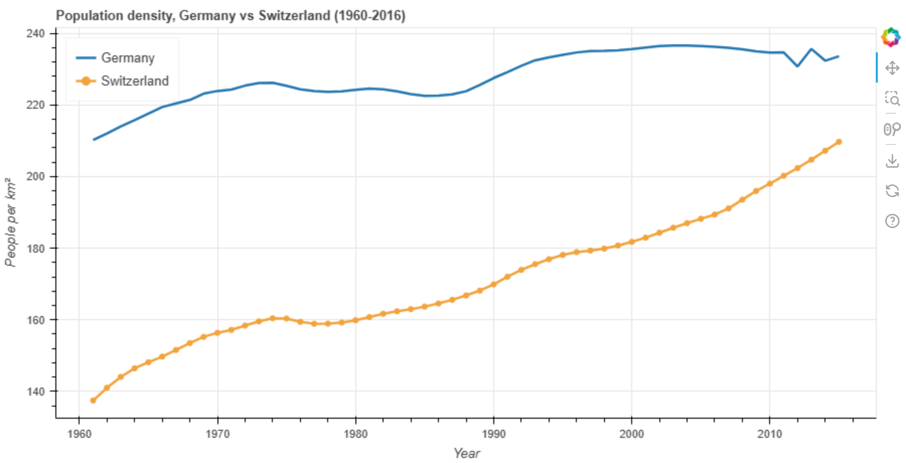
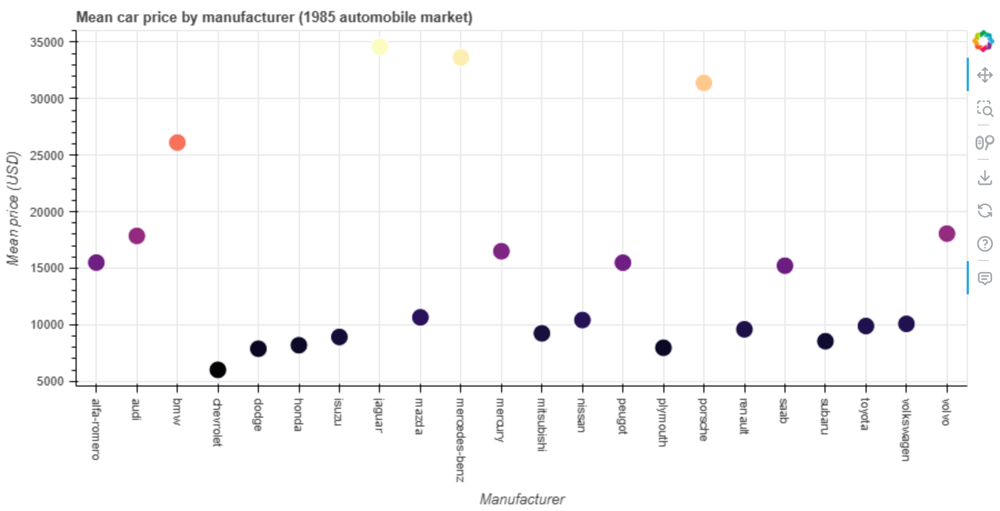
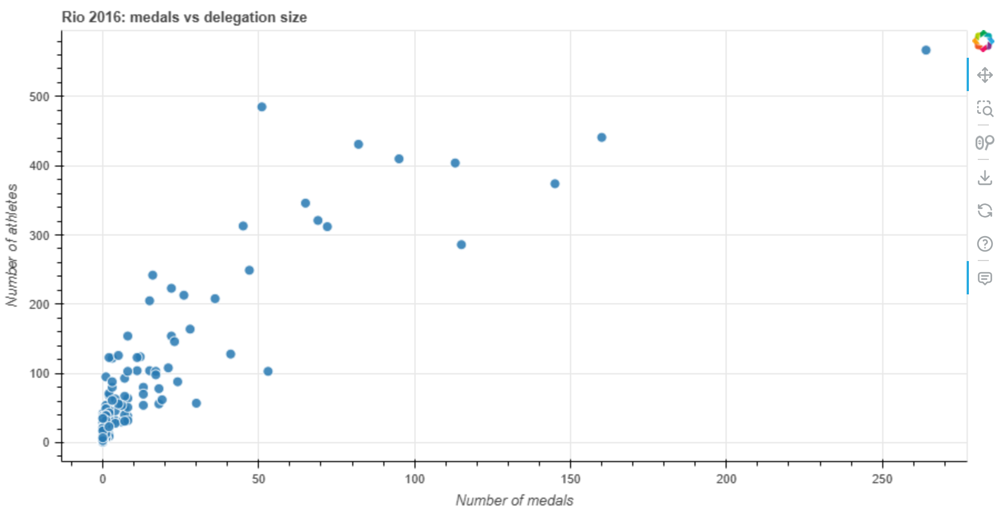

# Visual analytics of population density, car prices and Olympic performance

A reproducible **Bokeh** data-visualisation project: three public datasets analysed with
pandas and turned into interactive figures. Built for my CISC7204 data science portfolio.

| | |
|---|---|
| **Author** | CHAN KA WAI (mc64933) |
| **Course** | CISC7204 Data Science and Data Visualization, University of Macau |
| **Status** | Completed (course project, 2026) |
| **Portfolio site** | https://kelvin-chan-ka-wai.github.io/data-science-portfolio/ |
| **License** | Code MIT, data under the licences listed below |

## Problem / research questions

Data visualisation only earns its keep when a reader can answer a real question from the
picture. This project asks three questions against three different public datasets:

1. **Population** - How have population densities in Germany and Switzerland evolved between
   1961 and 2015, and has the gap between the two countries narrowed?
2. **Prices** - How much do the mean prices of car manufacturers actually differ, and how
   skewed is the price distribution of the 1985 automobile market?
3. **Olympics** - How strongly does a country's medal total depend on the size of its
   delegation at the 2016 Rio Olympics, and which countries were the most "efficient"?

## Datasets and usage permissions

| File | Source | Content | Permission |
|---|---|---|---|
| `data/world_population.csv` | World Bank, World Development Indicators (population density, `EN.POP.DNST`) | 264 countries/aggregates x 60 columns, years 1960-2016 | CC BY 4.0 - public development statistics |
| `data/automobiles.csv` | UCI Machine Learning Repository, *Automobile* dataset (1985) | 201 cars x 14 attributes | CC BY 4.0 - public research dataset |
| `data/olympia2016_athletes.csv` | Rio 2016 Olympic athletes dataset, distributed with the CISC7204 tutorial (originally a Kaggle dataset) | 11,538 athletes x 11 columns | Public / CC0-style; no personal or sensitive attributes beyond what the public Olympic record contains |

All three are **aggregated public statistics**. No passwords, API keys, private information or
restricted datasets are included in this repository; see `data/README.md` for details.

## Methods and tools

- **Python 3.9** with **pandas 2.1** for loading, cleaning, grouping and aggregation.
- **NumPy** for the summary statistics (means, Pearson correlation).
- **Bokeh 3.4** for the visualisations: the high-level `plotting` interface for line, circle and
  scatter glyphs, the `gridplot` layout, `LinearColorMapper` for colour encoding, `HoverTool`
  for tooltips and `TabPanel`/`Tabs` for tabbed views.
- **ipywidgets 8.1** (`interact`, `IntSlider`) for the interactive filters in the Olympics
  notebook.
- **Jupyter** notebooks, executed top-to-bottom so every output in `notebooks/` is a real
  result.
- **Git / GitHub** for version control and **GitHub Pages** for the portfolio site.

## Key findings

1. **Population density converged.** Germany moved from 210.2 to 233.6 people/km² (+11.1%)
   while Switzerland moved from 137.5 to 209.7 (+52.5%) between 1961 and 2015, so the gap
   between the two countries shrank from **72.7 to 23.9 people/km²** - a 67% narrowing.
2. **Car prices are strongly skewed and brand-driven.** The mean price per manufacturer in the
   1985 market ranges from **6,007 USD** (Chevrolet) to **34,600 USD** (Jaguar), a factor of
   **5.8x**, while the median car costs only 10,295 USD; 14 of the 201 cars cost more than
   30,000 USD.
3. **Medals follow delegation size.** Across the 207 countries at Rio 2016 the number of medals
   is strongly correlated with the number of athletes (**Pearson r = 0.87**): the USA sent 567
   athletes and won 264 medals. Among countries with at least 20 athletes, Jamaica (57 athletes
   -> 30 medals, 0.53 per athlete) and Serbia (103 -> 53, 0.51) converted their athletes into
   medals more efficiently than the USA (0.47).

## Key limitation

**Correlation is not causation, and aggregation hides the detail.** The Olympic correlation
(r = 0.87) is a descriptive association: larger delegations naturally compete in more events,
and the dataset counts *athletes*, not medal events, so team sports multiply a single medal
across many athletes. Likewise the population series are country-level World Bank aggregates
that ignore internal regional variation, and the automobile prices are a 1985 snapshot in USD
without inflation adjustment. None of the visualisations supports a causal claim, and the
"efficiency" ranking in particular should not be read as a performance measure.

## Visualisations

**1. Population density, Germany vs Switzerland (1961-2015)** - the two curves and their
convergence.



**2. Mean car price by manufacturer** - the same means as the table, colour-encoded with the
`Magma256` palette so the price gradient is visible at a glance.



**3. Rio 2016: medals vs delegation size** - one marker per country, with hover tooltips for
the gold/silver/bronze split in the notebook version.



## How to run the analysis

```bash
# 1. clone
git clone https://github.com/Kelvin-Chan-Ka-Wai/data-science-project.git
cd data-science-project

# 2. environment (Python 3.9+)
python -m venv .venv
# Windows: .venv\Scripts\activate   |  macOS/Linux: source .venv/bin/activate
pip install -r requirements.txt

# 3. run the notebooks, either interactively
jupyter notebook notebooks/
#    ... or headless, executing every cell
jupyter nbconvert --to notebook --execute --inplace notebooks/01_population_density.ipynb
jupyter nbconvert --to notebook --execute --inplace notebooks/02_car_prices.ipynb
jupyter nbconvert --to notebook --execute --inplace notebooks/03_olympics_dashboard.ipynb

# 4. (optional) regenerate the figures as interactive HTML
python scripts/make_figures.py
```

The datasets are already committed under `data/`, so no download step is needed; the notebooks
read `../data/<name>.csv`.

## Repository structure

```
data-science-project/
|-- README.md                  <- this file
|-- requirements.txt
|-- data/
|   |-- README.md              <- dataset sources and permissions
|   |-- world_population.csv
|   |-- automobiles.csv
|   `-- olympia2016_athletes.csv
|-- notebooks/
|   |-- 01_population_density.ipynb     <- questions 1 + gap over time
|   |-- 02_car_prices.ipynb             <- question 2
|   `-- 03_olympics_dashboard.ipynb     <- question 3, interactive Bokeh + ipywidgets
|-- figures/
|   |-- population_density_germany_switzerland.png
|   |-- car_mean_price_by_make.png
|   `-- olympics_medals_vs_athletes.png
`-- scripts/
    `-- make_figures.py        <- recreates the three figures as interactive HTML
```

## What I learned

Working through the tutorial code against modern library versions (the material was written for
Bokeh 0.x) taught me to read API changes - `plot_width` -> `width`, `Panel` -> `TabPanel`,
`add_glyph` -> explicit `GlyphRenderer`, `tooltips=` -> `HoverTool` - and to fix a real bug: a
`{'field': 'price', 'transform': colour_mapper}` colour specification needs a
`ColumnDataSource`, otherwise Bokeh reports `BAD_COLUMN_NAME` and draws nothing.
